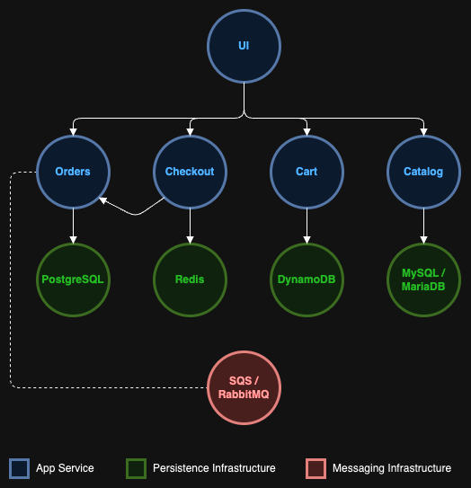

# retail-store

A five-service online shop (UI, catalog, cart, orders, checkout) used as the **target application** for an on-premises DevOps platform. Every build, release and deployment of this app is driven and visualised by **[Liveflow](#how-this-repo-fits-with-liveflow)**, a separate dashboard application.

The application code comes from the MIT-licensed [AWS retail store sample app](https://github.com/aws-containers/retail-store-sample-app). All of its original DevOps files (Dockerfiles, Compose, Helm, Terraform, CI) were removed; everything DevOps-related in this repo and in [`retail-store-gitops`](https://github.com/Muhamed404/retail-store-gitops) is being rebuilt from scratch, for on-premises servers only (no cloud services).

> **Status:** the DevOps files listed below exist but are **empty skeletons**. This README explains what each one is for, so they can be filled in one at a time.

---

## Contents

1. [The application](#the-application)
2. [Run the services on your laptop](#run-the-services-on-your-laptop)
3. [Two repositories](#two-repositories)
4. [Environments and delivery flow](#environments-and-delivery-flow)
5. [Repository structure](#repository-structure)
6. [File by file](#file-by-file)
7. [Service configuration reference](#service-configuration-reference)
8. [How this repo fits with Liveflow](#how-this-repo-fits-with-liveflow)
9. [Build order](#build-order)
10. [License](#license)

---

## The application



| Service | Language / framework | Port | Health check | Prometheus metrics | Stores data in (on-prem) | Calls |
|---|---|---|---|---|---|---|
| `ui` | Java 21, Spring Boot | 8080 | `/actuator/health` | `/actuator/prometheus` | — (no database) | catalog, cart, orders, checkout |
| `catalog` | Go 1.23, Gin | 8080 | `/health` | `/metrics` | MySQL | — |
| `cart` | Java 21, Spring Boot | 8080 | `/actuator/health` | `/actuator/prometheus` | DynamoDB Local (self-hosted container) | — |
| `orders` | Java 21, Spring Boot | 8080 | `/actuator/health` | `/actuator/prometheus` | PostgreSQL, publishes events to RabbitMQ | — |
| `checkout` | TypeScript, NestJS (Node) | 8080 | `/health` | `/metrics` | Redis | orders |

The health paths are what Docker healthchecks and Kubernetes probes call; the metrics paths are what Prometheus scrapes.

Every service can also run with `in-memory` storage, which is useful for a first build before any database exists.

`cart` was written for Amazon DynamoDB. On-prem it points at **DynamoDB Local**, a container that speaks the same API, through `RETAIL_CART_PERSISTENCE_DYNAMODB_ENDPOINT`. No AWS account is needed.

---

## Run the services on your laptop

Each service starts alone with built-in in-memory data, so you do **not** need any database to try it. Details, checks and common problems are in each service's README: [ui](src/ui/README.md) · [catalog](src/catalog/README.md) · [cart](src/cart/README.md) · [orders](src/orders/README.md) · [checkout](src/checkout/README.md).

| Service | Needs | Start command (from its folder) | Check |
|---|---|---|---|
| ui | Java 21 | `./mvnw spring-boot:run` | `curl localhost:8080/actuator/health` |
| catalog | Go 1.23+ | `go build -o catalog main.go && ./catalog` | `curl localhost:8080/health` |
| cart | Java 21 | `./mvnw spring-boot:run` | `curl localhost:8080/actuator/health` |
| orders | Java 21 | `./mvnw spring-boot:run` | `curl localhost:8080/actuator/health` |
| checkout | Node 20+, yarn | `yarn install && yarn serve` | `curl localhost:8080/health` |

All five use port 8080 by default, so to run **several at once** give each its own `PORT`. This works (open <http://localhost:8080> at the end; the UI then shows real data from the catalog service):

```bash
# one terminal each, from the repository root
(cd src/catalog  && go build -o catalog main.go && PORT=8081 ./catalog)
(cd src/cart     && PORT=8082 ./mvnw spring-boot:run)
(cd src/orders   && PORT=8083 ./mvnw spring-boot:run)
(cd src/checkout && yarn install && PORT=8084 RETAIL_CHECKOUT_ENDPOINTS_ORDERS=http://localhost:8083 yarn serve)
(cd src/ui       && PORT=8080 \
   RETAIL_UI_ENDPOINTS_CATALOG=http://localhost:8081 \
   RETAIL_UI_ENDPOINTS_CARTS=http://localhost:8082 \
   RETAIL_UI_ENDPOINTS_ORDERS=http://localhost:8083 \
   RETAIL_UI_ENDPOINTS_CHECKOUT=http://localhost:8084 ./mvnw spring-boot:run)
```

The easier way to run everything, with the real databases, is `docker compose up` from the repository root. That file is written in Phase 2 (issue #9).

---

## Two repositories

| Repo | Holds | Changed by | Triggers |
|---|---|---|---|
| **`retail-store`** (this repo) | application code, Dockerfiles, Compose file for dev, Jenkinsfiles, k6 load test | developers | Jenkins builds, tests and pushes images |
| **[`retail-store-gitops`](https://github.com/Muhamed404/retail-store-gitops)** | Helm charts, environment values, ArgoCD apps, cluster add-ons, monitoring, Ansible | Jenkins (writes new image tags), platform changes | ArgoCD deploys whatever it says |

Why two repos:

1. **No build loops.** After each build Jenkins commits the new image tag. If that commit landed here it would trigger Jenkins again, forever. In the GitOps repo it only wakes ArgoCD.
2. **Deployment history is clean.** The GitOps repo's history is exactly "what ran in staging and prod, and when". Rolling back means reverting a commit there.
3. **Permissions.** Developers can push code without being able to change production settings; ArgoCD only needs read access to the GitOps repo.

```
developer push ──► [retail-store] ──► Jenkins: test, build, scan, push image to Harbor
                                              │ commits the new image tag
                                              ▼
                                  [retail-store-gitops] ──► ArgoCD ──► Kubernetes
```

---

## Environments and delivery flow

| Environment | Runs on | Deployed by | Trigger | Who approves |
|---|---|---|---|---|
| **dev** | Docker Compose on a dev server | Jenkins (SSH + `docker compose up -d`) | push to the `dev` branch | nobody, automatic |
| **staging** | Kubernetes cluster `cluster-stg` | ArgoCD, **auto-sync** | merge `dev` → `staging` | nobody, automatic |
| **prod** | Kubernetes cluster `cluster-prod` (separate cluster) | ArgoCD, **manual sync** | a release created from Liveflow | a person clicks **Sync** in Liveflow |

Image tags: dev and staging images are tagged `stg-<short-commit-sha>`, production images `vX.Y.Z` (the release tag).

---

## Repository structure

Files marked **(empty)** are DevOps skeletons to fill in. Everything else is application code kept from upstream.

```
retail-store/
├── README.md                     this file
├── LICENSE                       MIT licence of the original app (must stay)
├── CHANGELOG.md                  upstream app history, kept for reference
├── CODE_OF_CONDUCT.md            upstream
├── CONTRIBUTING.md               upstream
├── .gitignore                    ignores build output (target/, node_modules/, dist/ ...)
├── .prettierrc / .prettierignore code formatting settings
│
├── docker-compose.yml            (empty) the whole dev environment: 5 services + 5 data stores
├── .env.example                  (empty) every variable Compose needs, with safe example values
│
├── jenkins/
│   ├── Jenkinsfile.dev           (empty) push to dev → build → deploy to the dev server with Compose
│   ├── Jenkinsfile.staging       (empty) merge to staging → build, scan, push → update values-stg.yaml
│   ├── Jenkinsfile.prod          (empty) started by Liveflow only: VERSION + ACTION (release | rollback)
│   └── Jenkinsfile.k6            (empty) started by Liveflow only: TARGET_URL, VUS, DURATION
│
├── k6/
│   └── stress.js                 (empty) k6 load test: browse, add to cart, check out
│
├── docs/                         architecture diagram, feature notes, screenshots
├── samples/                      reference copy of product images and product data
│
└── src/
    ├── ui/        Dockerfile (empty), .dockerignore (empty), pom.xml, mvnw, src/, scripts/
    ├── catalog/   Dockerfile (empty), .dockerignore (empty), main.go, go.mod, api/ ... test/
    ├── cart/      Dockerfile (empty), .dockerignore (empty), pom.xml, mvnw, src/, openapi.yml
    ├── orders/    Dockerfile (empty), .dockerignore (empty), pom.xml, mvnw, src/, events/, openapi.yml
    ├── checkout/  Dockerfile (empty), .dockerignore (empty), package.json, src/, test/, openapi.yml
    ├── e2e/       Cypress end-to-end tests for the whole shop
    ├── load-generator/  original Artillery load scenario (kept for reference; the pipeline uses k6/)
    └── misc/style/      Java checkstyle rules used by the Maven builds
```

---

## File by file

### `docker-compose.yml` (empty)

The **dev environment**. Jenkins copies this file to the dev server and runs `docker compose up -d`. It should define:

| Compose service | Image | Why |
|---|---|---|
| `ui` | built from `src/ui` | the shop front end, the only service published to the host (e.g. port 8888) |
| `catalog` | built from `src/catalog` | product API |
| `cart` | built from `src/cart` | cart API |
| `orders` | built from `src/orders` | order API |
| `checkout` | built from `src/checkout` | checkout API |
| `catalog-db` | `mysql:8` | catalog storage |
| `orders-db` | `postgres:16` | orders storage |
| `rabbitmq` | `rabbitmq:3-management` | order events |
| `checkout-redis` | `redis:7` | checkout sessions |
| `carts-db` | `amazon/dynamodb-local` | cart storage, the on-prem replacement for DynamoDB |

Add a **healthcheck** to every service and `depends_on: condition: service_healthy`, so the APIs start only after their database is ready. Use the project name `retail-store`: Liveflow finds the dev containers through the Docker label `com.docker.compose.project`.

Monitoring for the dev server (Prometheus, cAdvisor, Promtail) lives in the GitOps repo: `monitoring/compose/docker-compose.monitoring.yml`.

### `.env.example` (empty)

Lists every variable `docker-compose.yml` reads (database names, users, passwords, image tag), with **example values only**. Copy it to `.env` on the dev server; `.env` itself is never committed.

### `src/<service>/Dockerfile` (empty, ×5)

One per service, built by Jenkins and pushed to Harbor. Recommended shape, **multi-stage** so the final image holds only what runs:

| Service | Build stage | Runtime stage |
|---|---|---|
| `ui`, `cart`, `orders` | Maven + JDK 21: `./mvnw -DskipTests package` | JRE 21 slim, runs the jar |
| `catalog` | Go: `go build` with `CGO_ENABLED=0` | distroless or Alpine, copies the binary |
| `checkout` | Node 20: `yarn install` + `yarn build` | Node 20 slim, production dependencies only |

Rules for all five: run as a **non-root user**, `EXPOSE 8080`, and set a `HEALTHCHECK` on the service's health path (see the table above). `catalog` embeds its product data at build time (`repository/products.json`) and `ui` ships its own images, so no extra files need copying in.

### `src/<service>/.dockerignore` (empty, ×5)

Keeps the build context small and secrets out of images: exclude `target/`, `node_modules/`, `dist/`, `.git`, `*.md`, local `.env` files and test reports.

### `jenkins/Jenkinsfile.dev` (empty)

| | |
|---|---|
| Trigger | GitHub webhook, push to `dev` |
| Parameters | none |
| Stages | Checkout → Test (each service's unit tests) → Build images → Push to Harbor → Deploy over SSH: copy `docker-compose.yml`, `docker compose pull && docker compose up -d` → Smoke test |

### `jenkins/Jenkinsfile.staging` (empty)

| | |
|---|---|
| Trigger | GitHub webhook, merge into `staging` |
| Parameters | none |
| Stages | Checkout → Test → Build images tagged `stg-<sha>` → Trivy scan → Push to Harbor → clone `retail-store-gitops`, set the tag in `helm/environments/values-stg.yaml`, commit and push |
| Result | ArgoCD sees the commit and syncs staging automatically |

### `jenkins/Jenkinsfile.prod` (empty)

| | |
|---|---|
| Trigger | **Liveflow only.** No webhook: Liveflow creates the Git tag and starts this job, a webhook would run it twice |
| Parameters | `VERSION` (e.g. `v2.3.0`), `ACTION` (`release` or `rollback`) |
| `release` | Checkout the tag → Test → Build images tagged `VERSION` → Trivy scan → Push → set the tag in `values-prod.yaml`, commit and push |
| `rollback` | Skip the build (the image already exists in Harbor) → only set `values-prod.yaml` back to `VERSION` |
| Result | ArgoCD shows prod as **OutOfSync** and waits. Nothing changes until someone clicks Sync in Liveflow |

### `jenkins/Jenkinsfile.k6` (empty)

| | |
|---|---|
| Trigger | **Liveflow only** (Stress page) |
| Parameters | `TARGET_URL`, `VUS` (virtual users), `DURATION` (e.g. `120s`) |
| Stages | Run `k6/stress.js` with those values |
| Must | stop cleanly when Liveflow aborts the build (one test per environment at a time) |

All Jenkinsfiles should end by setting `currentBuild.description = "image=<registry>/<service>:<tag>"`, which Liveflow shows as "pushed <tag>". Liveflow draws the stage list straight from these files, so stage names are what people see on the dashboard.

### `k6/stress.js` (empty)

The load test the k6 job runs. It reads `TARGET_URL`, `VUS` and `DURATION` from the environment and walks a real shopper path: home page → product list → product page → add to cart → checkout. The load pushes CPU up so the HPA adds pods, which Liveflow shows live.

### Application folders (kept, not DevOps)

| Path | What it is |
|---|---|
| `src/<service>/src`, `main.go`, `api/` ... | the service code |
| `src/<service>/openapi.yml` | the service's API contract |
| `src/<service>/scripts/generate-*.sh` | code generation from the OpenAPI specs (developer tooling) |
| `src/<service>/ATTRIBUTION.md` | licences of the service's third-party libraries |
| `src/ui`, `cart`, `orders`: `mvnw`, `.mvn/` | Maven wrapper, so builds don't need Maven installed |
| `src/e2e/` | Cypress tests that click through the whole shop; can run in a pipeline stage against staging |
| `src/load-generator/` | the original Artillery scenario, kept for reference |
| `src/misc/style/java/` | checkstyle rules used by the Java builds |
| `samples/` | reference copy of the product images and product data (the services embed their own copies) |
| `docs/` | architecture diagram and feature notes |

---

## Service configuration reference

Every service listens on `PORT` (default `8080`). Values shown are what the **on-prem** setup uses.

**ui**
| Variable | Value |
|---|---|
| `RETAIL_UI_ENDPOINTS_CATALOG` | `http://catalog:8080` |
| `RETAIL_UI_ENDPOINTS_CARTS` | `http://cart:8080` |
| `RETAIL_UI_ENDPOINTS_ORDERS` | `http://orders:8080` |
| `RETAIL_UI_ENDPOINTS_CHECKOUT` | `http://checkout:8080` |
| `RETAIL_UI_THEME` | `default`, `green`, `orange` or `teal` (handy to show which version is live) |

**catalog**
| Variable | Value |
|---|---|
| `RETAIL_CATALOG_PERSISTENCE_PROVIDER` | `mysql` |
| `RETAIL_CATALOG_PERSISTENCE_ENDPOINT` | `catalog-db:3306` |
| `RETAIL_CATALOG_PERSISTENCE_DB_NAME` | `catalogdb` |
| `RETAIL_CATALOG_PERSISTENCE_USER` | `catalog_user` |
| `RETAIL_CATALOG_PERSISTENCE_PASSWORD` | secret |

**cart**
| Variable | Value |
|---|---|
| `RETAIL_CART_PERSISTENCE_PROVIDER` | `dynamodb` |
| `RETAIL_CART_PERSISTENCE_DYNAMODB_ENDPOINT` | `http://carts-db:8000` (DynamoDB Local) |
| `RETAIL_CART_PERSISTENCE_DYNAMODB_TABLE_NAME` | `Items` |
| `RETAIL_CART_PERSISTENCE_DYNAMODB_CREATE_TABLE` | `true` |
| `AWS_ACCESS_KEY_ID` / `AWS_SECRET_ACCESS_KEY` | any dummy text, but **must be set** |

DynamoDB Local accepts any credentials, but the AWS client still fails with `Unable to load credentials` if these two are not set (`AWS_REGION` is not needed). Put dummy values in `.env` (Compose) and in the ConfigMap or Secret (Kubernetes).

**orders**
| Variable | Value |
|---|---|
| `RETAIL_ORDERS_PERSISTENCE_PROVIDER` | `postgres` (the upstream README wrongly lists this as `RETAIL_CHECKOUT_...`) |
| `RETAIL_ORDERS_PERSISTENCE_ENDPOINT` | `orders-db:5432` |
| `RETAIL_ORDERS_PERSISTENCE_NAME` | `orders` |
| `RETAIL_ORDERS_PERSISTENCE_USERNAME` | `orders_user` |
| `RETAIL_ORDERS_PERSISTENCE_PASSWORD` | secret |
| `RETAIL_ORDERS_MESSAGING_PROVIDER` | `rabbitmq` |
| `RETAIL_ORDERS_MESSAGING_RABBITMQ_ADDRESSES` | `rabbitmq:5672` |
| `RETAIL_ORDERS_MESSAGING_RABBITMQ_USERNAME` / `_PASSWORD` | secret |

**checkout**
| Variable | Value |
|---|---|
| `RETAIL_CHECKOUT_PERSISTENCE_PROVIDER` | `redis` |
| `RETAIL_CHECKOUT_PERSISTENCE_REDIS_URL` | `redis://checkout-redis:6379` |
| `RETAIL_CHECKOUT_ENDPOINTS_ORDERS` | `http://orders:8080` |

Passwords are never written into this repo: on the dev server they come from `.env`, in Kubernetes from Sealed Secrets in the GitOps repo.

---

## How this repo fits with Liveflow

Liveflow is a **separate application with its own repo and its own CI/CD**. It doesn't contain any of this app's code; it talks to the tools around it:

| Liveflow reads or does | Through | Depends on in this repo |
|---|---|---|
| shows pipeline stages and the live console | Jenkins API | stage names in the Jenkinsfiles |
| creates a release (`vX.Y.Z` tag) and starts the prod job | GitHub + Jenkins | `Jenkinsfile.prod` with `VERSION` / `ACTION` |
| runs a stress test | Jenkins | `Jenkinsfile.k6` with `TARGET_URL` / `VUS` / `DURATION` |
| shows dev containers | Prometheus + cAdvisor on the dev server | Compose project name `retail-store` |
| shows pods, rollouts and HPA | Kubernetes API | charts in `retail-store-gitops` |
| opens the production gate (Sync) | ArgoCD API | prod app in `retail-store-gitops` is manual-sync |

---

## Build order

1. **Dockerfiles**: get all five images to build and run with `in-memory` storage.
2. **`docker-compose.yml` + `.env.example`**: add the five data stores and switch each service to its real storage.
3. **`Jenkinsfile.dev`**: automate step 2 on the dev server.
4. Continue in [`retail-store-gitops`](https://github.com/Muhamed404/retail-store-gitops): servers, clusters, Helm, ArgoCD, monitoring.
5. **`Jenkinsfile.staging`**, then **`Jenkinsfile.prod`**, then **`k6/stress.js`** + **`Jenkinsfile.k6`**.

---

## License

The application code is from [aws-containers/retail-store-sample-app](https://github.com/aws-containers/retail-store-sample-app), licensed under the MIT License. See [LICENSE](LICENSE).
